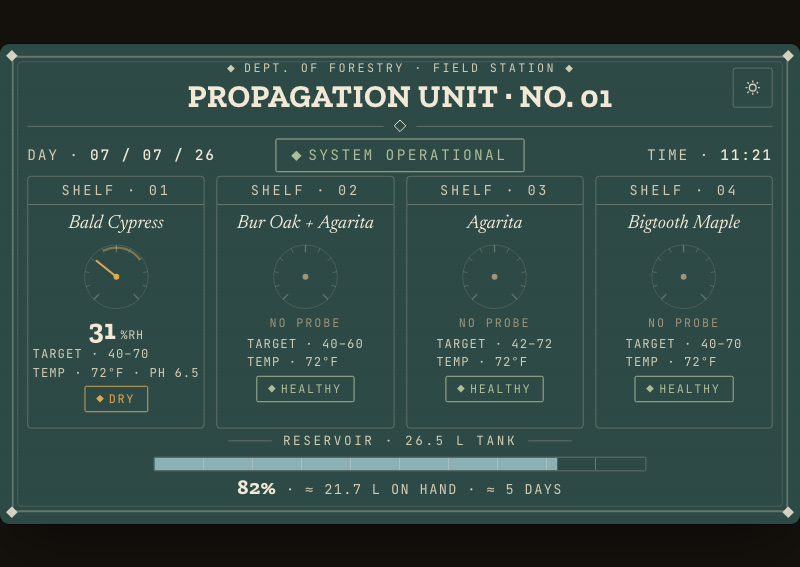
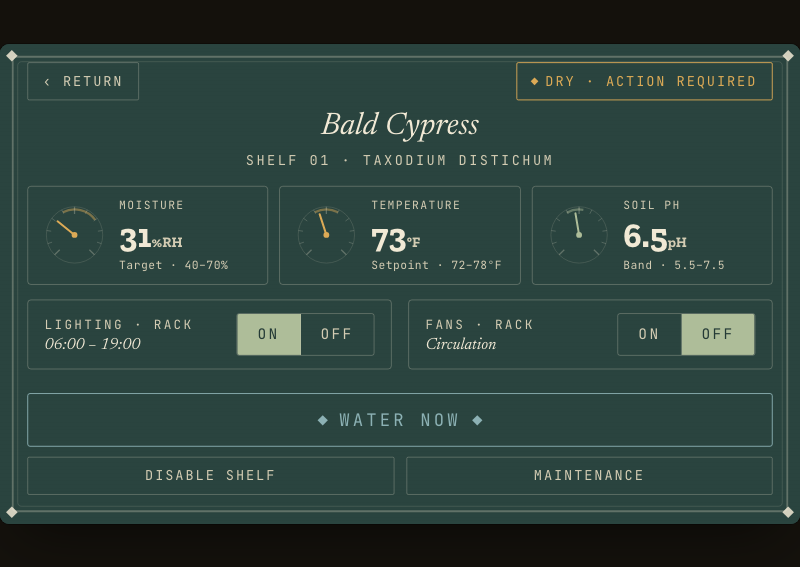
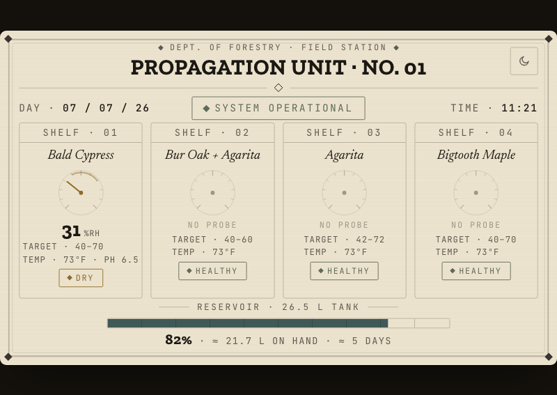
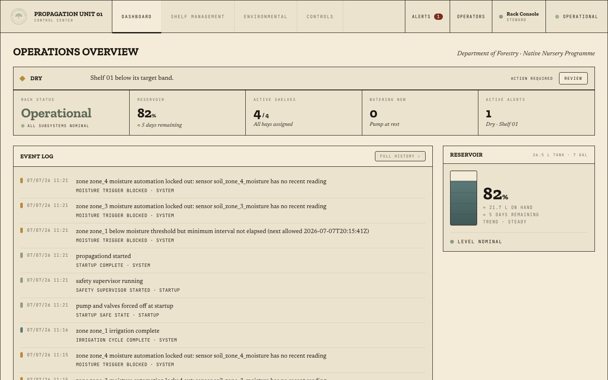

<div align="center">


# PROPAGATION UNIT · No. 01

**SHORT'S RESORT · DEPT. OF FORESTRY & FIRE**
FIELD STATION INSTRUMENTATION

`FILE NO. SR–PROP–02` · `SOFTWARE & CONTROL` · `FIELD YEAR 01`

*Texas Hill Country · Edwards Plateau · Lampasas River*
31°07′21.0″N · 98°02′52.9″W

</div>

---

## The Apparatus

Propagation Unit No. 01 is a semi-automated nursery rack: four shelves of
native Texas restoration stock — the cypress, oaks, persimmons, and their
kin bound for the riverbanks and shelterbelts of Short's Resort — raised
under managed light, water, and air. This repository is the unit's whole
nervous system: one Go daemon driving the pump, solenoids, lights, and fans;
reading the soil and the reservoir; enforcing the safety rules; keeping the
ledger; and presenting two faces to its operators.

The unit is a piece of field equipment that happens to have a screen. It
works with no internet, keeps its own records, waters on its own judgment
within limits a steward sets, and fails toward *off* — a dead controller
means closed valves and a resting pump, never a flooded floor.

<div align="center">
<br>
<sub>SURFACE A · THE RACK FACE — 5″ touchscreen, read standing, tapped gloved</sub>
</div>

## Two Surfaces, One Instrument

**The rack face** (`/ui/touch`) is the panel mounted on the unit itself: an
engraved apparatus of needle dials and status lamps on dark glass, with a
limestone day-mode for bright mornings. Tap a shelf plate for its detail —
moisture, temperature, soil pH — and *Water Now* runs a real, bounded,
safety-checked pump cycle. No sign-in at the rack: standing in front of the
machine is credential enough.

<div align="center">

<br>
<sub>SHELF DETAIL · AND THE LIMESTONE DAY MODE</sub>
</div>

**The control center** (`/`) is the paper surface for a grower at a desk:
operations overview, shelf management with specimen assignment from the
station's native catalog, environmental charts drawn from hourly aggregates,
per-shelf irrigation parameters, the field-notebook event log, and operator
administration.

<div align="center">
<br>
<sub>SURFACE B · THE CONTROL CENTER — anyone may watch; only operators may touch</sub>
</div>

Anyone with the unit's address sees everything, live. Turning anything on
requires a signed-in **Grower**; changing how the unit thinks requires a
**Steward**. Curious followers get the full aquarium view — the glass does
not open.

## What the Unit Does

- **Irrigation** — four independently valved shelves fed by one pump through
  a shared manifold. A strict queue guarantees *one shelf floods at a time*.
  Cycles run 1–30 minutes (the big pots soak long), stop early at a moisture
  target, and log reservoir and soil readings before and after.
- **Sensor-triggered watering** — per-shelf moisture rules with hysteresis,
  minimum rest intervals, daily cycle limits, and a lockout when a probe
  goes quiet. A shelf without a probe is *unmetered*, never presumed dry.
- **Lighting** — one photoperiod for the rack (on-at + hours-of-light, so the
  arithmetic can never exceed a day), manual overrides with expiry, and the
  correct scheduled state restored after any power loss.
- **Safety, layered** — a supervisor authorizes every relay-on; emergency
  stop latches until a human clears it; the pump has a hard runtime ceiling;
  low or unreadable reservoir locks watering out; relay-level timers back up
  the software; and an independent **watchdog process** restarts a dead
  daemon or, failing that, seizes the relay port and forces the safe state.
- **The record** — every relay click, sensor poll, watering cycle, sign-in,
  and safety event is written down. Raw readings keep 30 days; hourly
  aggregates keep forever. Live changes stream to both surfaces in under a
  second.
- **Simulation** — the entire unit runs without hardware (`make run-sim`),
  with mock relays and drifting mock sensors. Everything in this repository
  was built and verified that way before the first wire is crimped.

## Manifest of Parts

| # | Part | Duty | Channel / Bus | Notes |
|---|------|------|---------------|-------|
| 1 | **Piconium** (Embedded Now, Kit 002 or 003) | The unit's mind | — | x86-64, 4 GB RAM, NVMe for OS & records. Kit 003's Atom E3845 wants `intel_idle.max_cstate=1`. |
| 2 | **Numato Lab 8-channel USB relay module** | The unit's hands | USB · `/dev/ttyACM*` | Loads wired **normally-open**: de-energized = off. All channels spoken for at 6 shelves — expansion means a second board. |
| 3 | **Barina grow lights** | Photoperiod | Relay 1 | 120 VAC — the only mains load. Rack-wide circuit; per-shelf dark via the physical switch. |
| 4 | **SEAFLO diaphragm pump** | Water from jug to manifold | Relay 2 | 12 VDC. Verify amperage against ~7 A contacts; interpose an automotive relay if close. Flyback diode. |
| 5 | **U.S. Solid JFSV00012 solenoid valves ×4** | One per shelf | Relays 3–6 | 12 VDC, **normally closed** — power loss seals the water in the jug. Flyback diodes. |
| 6 | **12 V USB desk fans** (plugs stripped) | Air across the canopy | Relay 7 | Single speed, ganged as one circuit, one honest toggle. |
| 7 | **Waveshare 5″ touchscreen** (800×480) | The rack face | HDMI + USB HID | No drivers. UI drawn on an 880×528 canvas, scaled exactly. |
| 8 | **Xiusiyt RS485-WE-1800-BT cable** | The sensor party line | USB · `/dev/ttyUSB*` | Genuine FT232RQ + SP485EN, auto TX-direction, Tx/Rx lamps. Jumper Term1↔Term2 for 120 Ω termination. |
| 9 | **RS485 soil probes** (moisture · temp · pH) | Per-shelf ground truth | Modbus RTU, 9600 8N1 | IP68, 12 V. Ship at address 1 — commission **one at a time** and re-address. Register maps verified at the bench. |
| 10 | **Submersible level transmitter** (SS304) | Reservoir eyes | Modbus RTU | Hydrostatic; reports water column — calibrated empty/full to percent. |
| 11 | **7-gallon jug** (26.5 L) | The reservoir | — | Days-remaining estimated until pump flow is calibrated. |
| 12 | 12 V supply, common ground, flyback diodes | Housekeeping | — | Sensor power from the 12 V rail — *never* the RS485 cable's 5 V pin. One ground for rail and bus. |

Full electrical notes, wiring cautions, and open bench questions:
[`docs/HARDWARE.md`](docs/HARDWARE.md).

## The Nervous System

```
propagationd ──── one static Go binary, SQLite, both UIs embedded
 ├─ device manager      sole owner of the relays · audit log · bounded timers
 ├─ safety supervisor   authorizes every relay-on · e-stop latch · lockouts
 ├─ irrigation engine   the one-shelf-at-a-time queue · cycle state machine
 ├─ lighting service    photoperiod · overrides · restore-after-reboot
 ├─ automation          moisture rules & schedules — they only ever enqueue
 ├─ sensor service      generic JSON-configured Modbus driver · hot reload
 ├─ retention           hourly aggregates forever · raw pruned at 30 days
 ├─ auth                bcrypt · sessions · Steward / Grower / Viewer
 └─ event stream        SSE push to every open surface

propagation-watchdog ── separate binary; restarts the daemon, or stops it,
                        takes the relay port, and forces pump & valves off
```

Two rules bind everything: **nothing touches hardware except the device
manager**, and **nothing turns on without the safety supervisor's leave.**
The test suite (12 packages) includes a proof that two shelves can never
flood at once and a rehearsal of the watchdog's full escalation ladder.

## Running It

```sh
make run-sim     # the whole unit, simulated — http://localhost:8080
make test        # all 12 packages
make web         # rebuild the two surfaces and embed them
make linux       # both static x86-64 binaries for the Piconium → bin/
```

First boot greets you with **Unit Setup** — create the steward account (only
accepted from the unit's own network), and the rack is yours.

## Papers on File

| Document | Contents |
|---|---|
| [`docs/SPEC.md`](docs/SPEC.md) | The founding specification — architecture, schema, API, safety rules |
| [`docs/HARDWARE.md`](docs/HARDWARE.md) | Physical inventory, protocols, wiring cautions, relay budget |
| [`docs/deployment.md`](docs/deployment.md) | Debian 13 on the Piconium, kiosk, serial stability, eMMC & NVMe |
| [`docs/remote-access.md`](docs/remote-access.md) | Serving `unit01.shortsfieldstation.org` — tunnel, TLS, the trust model |
| [`docs/HANDOFF.md`](docs/HANDOFF.md) | The complete working record: decisions, sharp edges, bench checklist |

## Station Log

Software: **feature-complete and verified in simulation.** Awaiting the
bench: hardware bring-up, sensor commissioning, register-map verification,
hardware-in-the-loop safety trials, pump flow calibration, and the tunnel to
the field station's domain.

---

<div align="center">
<sub>SHORT'S RESORT FIELD STATION · GROWTH & RENEWAL · FY·10<br>
CONFIDENTIAL · WORKING EQUIPMENT · KEEP WATER OFF THE FLOOR</sub>
</div>
